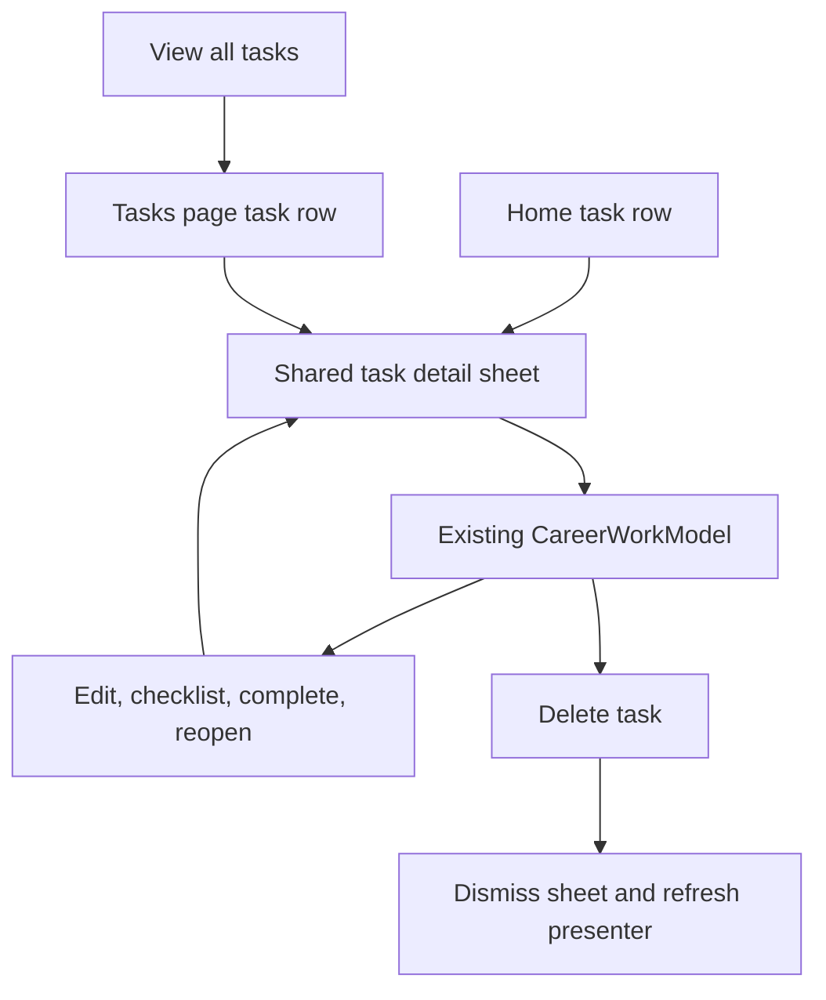

# Task Detail Sheet Design

## Intent

Keep task inspection close to the list where the user found the task. A task tap opens detail without moving the user to another page.

## Approved behavior

- “View all tasks” is the only Home control that opens the Tasks page.
- Tapping a task on Home opens the task detail in a sheet.
- Tapping a task on the Tasks page opens the same sheet.
- The sheet starts at medium height and can expand to the large height by dragging.
- Closing the sheet returns to the page where it opened.
- Editing, checklist work, completion, reopening, and deletion use the existing task model.
- A successful deletion closes the sheet and refreshes the presenting page.
- Other task changes refresh the sheet and the presenting page.

## Non-goals

- Do not create a second task detail implementation.
- Do not route through the Tasks page before presenting the sheet.
- Do not change task storage or lifecycle rules.
- Do not add feature-local sheet styling.

## Component inventory

| Element | Verdict | File or component |
|---|---|---|
| Expandable sheet presentation | New shared contract | `TaisaExpandableSheet` in `TaisaDesignSystem` |
| Task detail content | Reuse and expose | Existing `CareerActionDetail` in `CareerWorkView.swift` |
| Home task row | Modify interaction | `HomeActionsPreviewSection` |
| Tasks collection row | Modify interaction | `CareerWorkView` task collection |
| “View all tasks” row | Reuse | Existing `TaisaTaskSummaryRow` and `.actions` intent |

## Product architecture and states

The app shell owns Home sheet presentation because it already owns the shared `CareerWorkModel`. The Tasks page uses the same sheet presentation contract and the same detail component. Each presenter owns only the selected task identifier and sheet visibility.

## Design-system treatment

Add one shared expandable-sheet contract. It owns medium and large presentation positions, a visible drag indicator, semantic background treatment, and standard dismissal behavior. Product views provide content and selection state. No raw color, spacing, radius, material, or motion value is added.

## Accessibility

- The task row keeps its visible title as its activation label.
- The sheet announces the task title through its existing detail header.
- The drag indicator remains visible.
- Dismissal restores focus to the task row when the system can restore it.
- Existing detail actions keep their current labels and touch targets.

## Backend implications

None. The local encrypted task model already loads and mutates task detail.

## Approaches considered

1. App-shell-owned shared sheet for Home plus the same contract on Tasks. Selected because it reuses one model and one detail surface.
2. A Home-owned task model. Rejected because it would duplicate state and refresh behavior.
3. Route to Tasks before opening detail. Rejected because it breaks the approved navigation rule.

## Constraints

- SwiftUI on iOS and iPadOS 26 or later.
- Design-system components, semantic tokens, and Central Icons only.
- No feature-local substitutes or raw visual values.
- Existing and imported task data must remain valid.

## Status

Approved by Baah on 2026-11-19.
